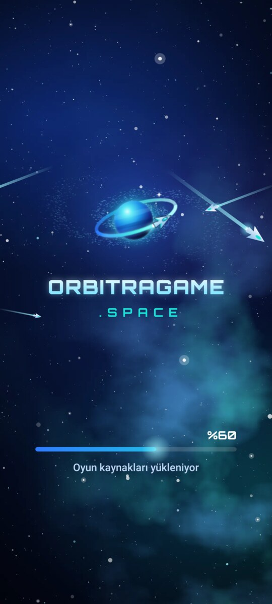
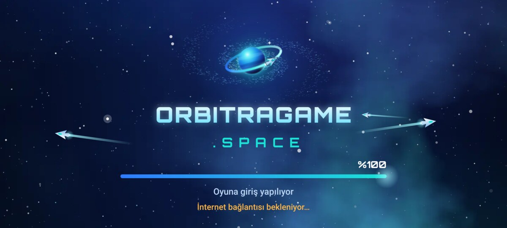
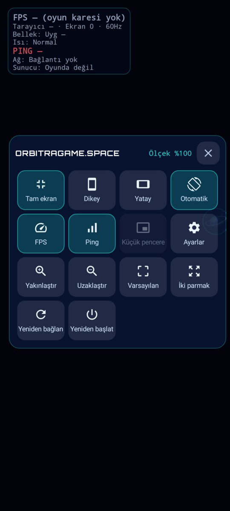

# ORBITRAGAME.SPACE — Android Oyun Uygulaması

`https://orbitragame.space/oyun` oyununa özel, adres çubuğu olmayan, tam ekran
çalışan bir Android (telefon + tablet) oyun tarayıcısı. Sıradan bir WebView
sarmalayıcısı değil; açılış ekranı, gerçek yükleme yüzdesi, FPS/Ping paneli,
küçük pencere (PiP), arka planda bağlantı koruma ve kontrollü yeniden bağlanma
içerir. Oyunun koduna, menülerine ve kontrollerine dokunmaz.

| Açılış ekranı | Yatay | Kontrol menüsü |
|---|---|---|
|  |  |  |

> Ekran görüntüleri Robolectric (gerçek Skia çizimi) ile üretildi; telefonda
> çekilmedi. Ayrıntılar için [docs/TEST_RAPORU.md](docs/TEST_RAPORU.md).

## Belgeler

- **Kurulum (telefon + Android Studio):** [docs/KURULUM.md](docs/KURULUM.md)
- **Dosya yerleşimi:** [docs/DOSYA_YERLESIMI.md](docs/DOSYA_YERLESIMI.md)
- **Test raporu (yapılan / yapılamayan testler):** [docs/TEST_RAPORU.md](docs/TEST_RAPORU.md)

## Özellikler

| Talep | Uygulamadaki karşılığı |
|---|---|
| Tek oyun adresi, adres çubuğu yok | Yalnızca `orbitragame.space` ve alt alan adları açılır; adres hiçbir yerde gösterilmez. Diğer bağlantılar onayla sistem tarayıcısında açılır. |
| Resmi simge ve kimlik | Özgün uzay temalı simge (adaptive + yuvarlak + Android 13 tema simgesi), açılış logosu, uzay arka planı, bildirim simgesi, son uygulamalar kimliği, Play Store simgesi ve tanıtım görseli (`branding/`). |
| Açılış ve yükleme ekranı | Hareketli yıldızlar, dönen spiral galaksi, uçan uzay gemileri. Yüzde %0/20/40/60/80/100 aşamaları **gerçek** olaylara bağlı (WebView oluşturuldu, istek gitti, sunucu yanıt verdi, Chromium'un gerçek yükleme ilerlemesi, sayfa yüklendi, oyun çizmeye başladı). Sahte zamanlayıcı yok. |
| Tarayıcı motoru | Cihazdaki güncel Chromium tabanlı Android System WebView; donanım hızlandırma, WebGL/WebGL2, Canvas, WebSocket, ses. Hiçbiri performans uğruna kapatılmadı. |
| Sunucu bağlantısı / arka plan | Otomatik küçük pencere (PiP) + ön plan servisi + renderer önceliği + sayfanın "gizli sekme" kısıtlamasına girmemesi + isteğe bağlı CPU/Wi-Fi kilidi. Döndürme/boyut değişiminde sayfa yeniden yüklenmez. Bağlantı koparsa önce oyunun kendi toparlanması beklenir, sonra artan aralıklarla yeniden bağlanılır. |
| Küçük pencere (PiP) | Ana ekrana dönünce otomatik veya menüden. Oyun yeniden boyutlanmadan küçültülür (oyun düzeni bozulmaz). Pencere sürüklenir, iki parmakla boyutlanır, kenara itilerek gizlenir, tek dokunuşla tam ekrana döner. |
| FPS / Ping paneli | Oyun FPS (anlık/ort./min), düşük FPS uyarısı, tarayıcı FPS, ekran FPS, ping (+sapma, kayıp), ağ türü, sunucu soket durumu, bellek, ısı, pil. Sürüklenebilir, dokununca küçülür. |
| Tam ekran ve yön | Gerçek tam ekran (sistem çubukları gizli), dikey / yatay / otomatik, çentik güvenli alanı, telefon + tablet. |
| Yakınlaştırma | Önce oyunun/tarayıcının kendi yakınlaştırma izni (sayfa izin veriyorsa). Ek olarak uygulama ölçeği (%60–%180): oyun koordinatlarını ve WebGL'i bozmadan görüş alanını değiştirir. İki parmak modu yalnızca menüden açılır ve o sırada oyuna dokunuş gitmez, böylece oyunun iki parmak hareketleriyle çakışmaz. |
| Kontrol menüsü | Sürüklenebilir yarı saydam düğme; 11 talep edilen işlem + otomatik yön, iki parmak zoom ve ayarlar. Kapalıyken oyun ekranını kaplamaz. |
| Güvenlik | HTTPS zorunlu, düz HTTP kapalı, SSL hatası asla atlanmaz, güvenilmeyen yönlendirmeler engellenir, `addJavascriptInterface` yok; köprü yalnızca oyun kaynağına açılan, doğrulanmış `WebMessageListener`. Şifre saklanmaz; çerezler bulut yedeğine girmez. |

## Mimari

```
OrbitraGame/
 ├─ core/   Saf Kotlin (Android bağımsız): alan adı güvenliği, yükleme yüzdesi,
 │          FPS/ping istatistiği, zoom, yeniden bağlanma, soket izleme.
 │          -> İleride iOS için Kotlin Multiplatform'a doğrudan taşınabilir.
 └─ app/    Android: WebView motoru, JS köprüsü, arayüz, PiP, servis, sistem izleme.
```

Ayrıntılar: [docs/DOSYA_YERLESIMI.md](docs/DOSYA_YERLESIMI.md).

## Hızlı derleme

```bash
cd OrbitraGame
./gradlew :core:test :app:testDebugUnitTest   # testler
./gradlew :app:assembleDebug                  # debug APK
./gradlew :app:assembleRelease                # release APK (keystore.properties gerekir)
```

## Lisanslar

- Menü simgeleri: Material Icons (Apache License 2.0).
- Marka yazı tipi: Orbitron (SIL Open Font License 1.1) — `branding/OFL-Orbitron-LICENSE.txt`.
- Uygulama simgesi ve görseller bu proje için özgün olarak üretildi.
