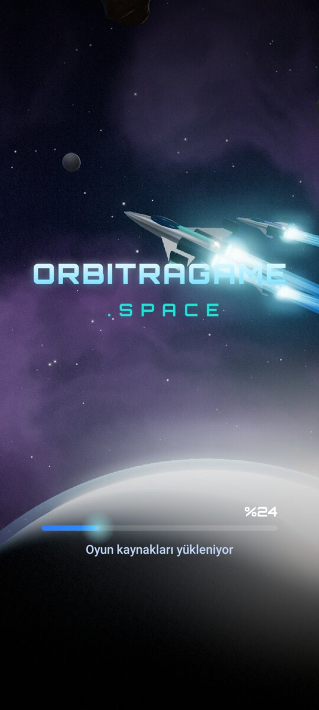
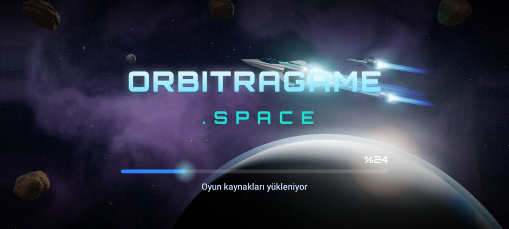
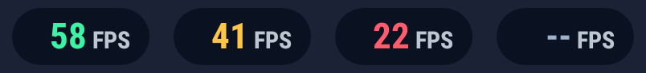

# ORBITRAGAME.SPACE — Android Oyun Uygulaması

`https://orbitragame.space/oyun` oyununa özel, adres çubuğu olmayan, tam ekran
çalışan hafif bir Android (telefon + tablet) oyun uygulaması. Oyunun koduna,
menülerine ve kontrollerine dokunmaz.

| Açılış (dikey) | Açılış (yatay) | Menü | FPS göstergesi |
|---|---|---|---|
|  |  |  |  |

> Ekran görüntüleri Robolectric (gerçek Skia çizimi) ile üretildi; telefonda
> çekilmedi. Ayrıntılar: [docs/TEST_RAPORU.md](docs/TEST_RAPORU.md).

## Belgeler

- **Kurulum (telefon + Android Studio):** [docs/KURULUM.md](docs/KURULUM.md)
- **Dosya yerleşimi:** [docs/DOSYA_YERLESIMI.md](docs/DOSYA_YERLESIMI.md)
- **Test raporu:** [docs/TEST_RAPORU.md](docs/TEST_RAPORU.md)

## v1.2.0 — Hafif sürüm

| İstek | Yapılan |
|---|---|
| Telefonu yormasın, takılmasın | Oyun sırasında periyodik ölçüm **yok**. Bellek ölçümü (`Debug.getPss`, Android'de pahalıdır ve çizimi bekletebilir), her karede çalışan kare ölçer ve 2 saniyede bir ping kaldırıldı. Oyuna eklenen betik ~4 kat hafifledi (ölçüm: [test raporu](docs/TEST_RAPORU.md)). |
| Menüler hafif olsun | Menü bir kez oluşturulur, sonra yalnızca açılıp kapanır. Gölge, resim, bulanıklık ve ekranı karartan katman yok. |
| Az ayar, sade arayüz | Menüde 1 zoom satırı + 6 düğme. Ayarlarda 3 anahtar. Render kalitesi, 60 Hz, yeniden bağlanma, ekranın açık kalması, düşük gecikmeli Wi-Fi **otomatik**. |
| Sadece FPS görünsün | Köşede yalnızca "60 FPS" yazan küçük rozet (yeşil / sarı / kırmızı). Ayrıntı yok. |
| Uygulama boyutu | Release APK 4,5 MB → 2,4 MB (açılış videoları 720p'ye indirildi). |

## Menü

| Öğe | Ne yapar |
|---|---|
| − %100 + | Oyun ölçeği %30–%160. Yüzdeye dokun: %100'e döner. |
| FPS | FPS rozetini aç/kapat. |
| PC görünümü | Dokundukça: Kapalı → Orta (%75) → Güçlü (%60). Yalnızca üstteki pencereler (Gemi, P.E.T., Görev takibi, üst çubuk) küçülür; gemi ve harita aynı kalır. |
| Ekran yönü | Dokundukça: Otomatik → Yatay → Dikey. |
| Küçük pencere | Oyunu köşede küçük pencerede sürdürür. |
| Yeniden bağlan | Oyunu temiz şekilde yeniden yükler (giriş korunur). |
| Ayarlar | Arka planda bağlı kal · Küçük pencere · Kamera alanını kullan · Yeniden başlat |

## Otomatik çalışanlar

- **Render kalitesi:** Oyun tuvali en fazla x2 çözünürlükte çizilir. FPS uzun süre
  düşükse sessizce bir kademe (x1,5) düşer; işe yaramazsa geri alınır.
- **60 Hz kararlı ekran:** düzenli kare temposu, daha az ısınma.
- **Bağlantı:** WebSocket koparsa önce oyunun kendi toparlanması beklenir, sonra
  artan aralıklarla yeniden bağlanılır. Ana ekrana dönünce küçük pencere + arka
  plan servisi ile bağlantı korunur.
- **Klavye:** Oyun küçültülmez (siyah alan oluşmaz), gerekirse ekran yukarı kayar.
- **Güvenlik:** Yalnızca `orbitragame.space`, HTTPS zorunlu, SSL hatası asla atlanmaz,
  güvenli köprü (`WebMessageListener`), şifre saklanmaz, çerezler yedeklenmez.

## Mimari

```
OrbitraGame/
 ├─ core/   Saf Kotlin (Android bağımsız): alan adı güvenliği, yükleme yüzdesi,
 │          zoom, otomatik kalite, yeniden bağlanma, soket izleme.
 │          -> İleride iOS için Kotlin Multiplatform'a taşınabilir.
 └─ app/    Android: WebView motoru, sayfa köprüsü, arayüz, PiP, servis.
```

## Hızlı derleme

```bash
cd OrbitraGame
./gradlew :core:test :app:testDebugUnitTest   # testler
./gradlew :app:assembleDebug                  # debug APK
./gradlew :app:assembleRelease                # release APK (keystore.properties gerekir)
```

## Lisanslar

- Menü simgeleri: Material Icons (Apache License 2.0).
- Marka yazı tipi: Orbitron (SIL Open Font License 1.1) — `branding/OFL-Orbitron-LICENSE.txt`.
- Uygulama simgesi, açılış videosu ve görseller bu proje için özgün olarak üretildi.
