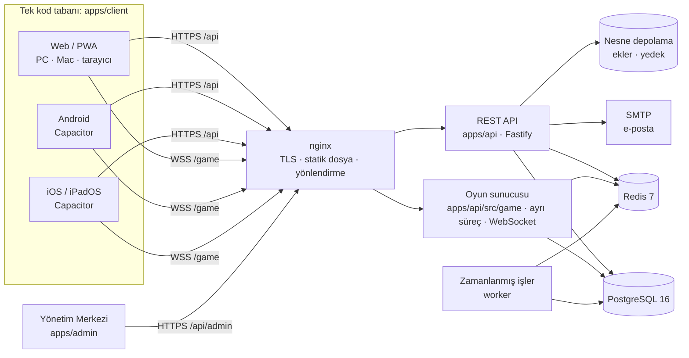
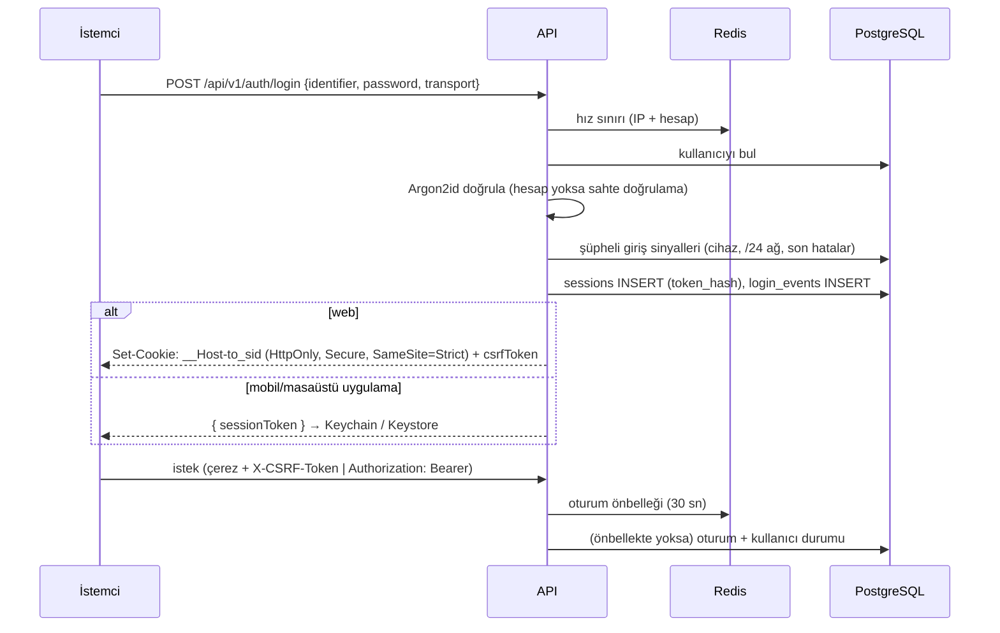

# 02 — Türk Orbit Teknik Mimarisi

## 1. Genel bakış



| Bileşen | Teknoloji | Görev | Durum |
|---|---|---|---|
| `apps/client` | TypeScript, React 18, Vite 7, Phaser 3.90 | Hesap ekranları, oyun, HUD. Web/PWA + Capacitor ile Android/iOS | Hesap ekranları ✅, oyun ekranı (tek oyunculu) ✅ |
| `apps/api` | Node.js 22, Fastify 5, zod, pg, ioredis, argon2 | Hesap, profil, hangar, ekonomi, görev, klan, forum, destek, yönetim REST API'si | Kimlik, profil, hangar, dünya ✅ |
| Oyun sunucusu (`apps/api/src/game`, ayrı süreç) | Node.js 22, `ws`, JSON protokol (ikili protokol Aşama 16) | Sunucu otoriteli gerçek zamanlı simülasyon: hareket ✅ (Aşama 8); savaş, NPC yapay zekâsı, ölüm, ödül ✅ (Aşama 9); görev olayları ✅ (Aşama 10) | Hareket, AOI, geçit, tek oturum, savaş, görev olayları ✅ |
| `apps/admin` | React (istemciyle ortak bileşenler) | TÜRK ORBIT YÖNETİM MERKEZİ | Aşama 14 |
| `packages/shared` | TypeScript + zod | Ortak tipler, doğrulama şemaları, roller, parola politikası, ağ protokolü ve deterministik hareket simülasyonu | ✅ |
| Worker | API ile aynı kod tabanında ayrı süreç | Günlük/haftalık sıfırlama, açık artırma kapanışı, sıralama, temizlik | Aşama 10-11 |
| PostgreSQL 16 | — | Kalıcı veri (tek doğruluk kaynağı) | ✅ |
| Redis 7 | — | Hız sınırı, oturum önbelleği, oyun bileti, çevrimiçi durum, pub/sub, canlı sıralama, grup durumu, harita devri | ✅ (hız sınırı, önbellek, bilet, çevrimiçi durum, tek oturum ve canlı değişiklik yayınları) |

**Neden mikroservis değil?** Başlangıçta iki çalıştırılabilir süreç (API + oyun sunucusu) ve tek veritabanı yeterli. Modüller (`modules/auth`, `modules/economy`…) klasör sınırlarıyla ayrılır. Ölçeklenme gerektiğinde yatay olarak çoğaltılan bileşen **oyun sunucusudur**, çünkü harita başına yük oradadır.

## 2. Teknoloji seçimlerinin gerekçesi

| Karar | Gerekçe |
|---|---|
| **TypeScript her yerde** | İstemci, API ve oyun sunucusu aynı tipleri ve doğrulama şemalarını paylaşır. Protokol uyumsuzluğu derleme anında yakalanır. |
| **Fastify** (Express yerine) | Daha yüksek performans, yerleşik şema/hook yapısı, olgun güvenlik eklentileri (helmet, cors, cookie). |
| **Ham SQL + `pg`** (ORM yerine) | Ekonomi ve envanterde satır kilitleri, kısıtlar ve transaction'lar açıkça kontrol edilmeli. Migration'lar okunabilir SQL dosyalarıdır. |
| **zod** | İstemcide anlık form doğrulaması, sunucuda kesin doğrulama: tek şema iki yerde kullanılır. `strictObject` ile beklenmeyen alanlar (ör. `role`) reddedilir. |
| **Argon2id** | Parola özetlemede güncel öneri (OWASP). 64 MiB bellek, 3 tur. |
| **Opak oturum anahtarı** (JWT yerine) | Anında iptal edilebilir (oturum kapatma, yasaklama, parola değişimi). Veritabanında yalnızca SHA-256 özeti tutulur. |
| **Phaser 3** (oyun motoru, Aşama 7) | WebGL + Canvas yedeği, mobil tarayıcılarda olgun, 2.5D sprite tabanlı uzay oyunu için yeterli. React yalnızca HUD/menü katmanında kalır. |
| **Capacitor** (mobil) | Aynı web kodu Android/iOS'ta yerel uygulama olarak paketlenir. Güvenli depolama ve titreşim gibi yerel API'lere erişim sağlar. |
| **WebSocket + ikili protokol** | Düşük gecikme, küçük paketler. Mobil veri kullanımını azaltır. |

## 3. Kimlik doğrulama mimarisi (Aşama 1 — uygulandı)



- **Roller:** Yeni hesap yalnızca `player` rolü alır. Bu kuralı veritabanı tetikleyicisi (`assign_default_player_role`) uygular. Kayıt şeması `role` gibi alanları reddeder. Yönetici rolü yalnızca sunucuda SSH ile çalıştırılan `role-cli` aracıyla verilir ve `admin_audit_log`'a yazılır. Aşama 14'te Yönetim Merkezi'ndeki `roles.assign` yetkisi ve iki yetkili onayı eklenecek.
- **CSRF:** Yalnızca `application/json` kabul edilir (form gönderimiyle saldırı yapılamaz). İzinli Origin denetimi yapılır. Çerez oturumunda durum değiştiren her istek, oturuma bağlı HMAC `X-CSRF-Token` başlığı ister.
- **Hesap varlığı gizliliği:** Kayıtlı e-posta ile kayıt ve şifremi unuttum aynı yanıtı döner. E-posta gönderimi arka planda yapılır, böylece yanıt süresi bilgi sızdırmaz. Olmayan hesaba girişte de Argon2 doğrulaması yapılır.

## 4. Gerçek zamanlı multiplayer mimarisi (Aşama 8 — uygulandı)

> **Uygulama durumu (Aşama 8):** Aşağıdaki tasarımın hareket, bilet, AOI, uzlaştırma, enterpolasyon, tek oturum ve yeniden bağlanma kısımları uygulandı ve test edildi. Uygulamadaki farklar:
> - Mesajlar şimdilik **JSON** (kısa alan adlarıyla). Ölçülen bant genişliği hedefin çok altında olduğu için ikili protokol Aşama 16'ya bırakıldı.
> - Oyun sunucusu ayrı bir süreçtir ama kodu `apps/api/src/game` altındadır (veritabanı, yapılandırma ve dünya kuralları tek kaynakta).
> - Tek süreç tüm haritaları çalıştırır. Birden çok süreç arasında "harita → sunucu" eşlemesi ve harita devri Aşama 16-17'dedir. Tek aktif oturum kuralı şimdiden süreçler arası çalışır (Redis yayını).
>
> - **Aşama 9:** Savaş da sunucu otoriteli olarak uygulandı. Hedef, ateş, mühimmat ve roket yalnızca niyettir; hasar, ölüm ve ödül sunucuda hesaplanır. Ödül hasar katkısına göre bölünür, tek transaction'da ve idempotent anahtarla yazılır.
>
> - **Aşama 10:** Görev ilerlemesi oyun sunucusu olaylarından beslenir. Yalnızca pilotun etkin hedefleriyle eşleşen olaylar biriktirilir ve saniyede bir toplu yazılır; istemciye `qp` ile bildirilir ([görev kuralları](Asama-10-Gorev-Sistemi/Gorev-Kurallari-ve-API.md)).
>
> Protokolün güncel hali: [Asama-08-Multiplayer/Protokol.md](Asama-08-Multiplayer/Protokol.md) + savaş ekleri [Asama-09-NPC-Savas/Savas-Kurallari-ve-Protokol.md](Asama-09-NPC-Savas/Savas-Kurallari-ve-Protokol.md) (protokol sürümü 2).

### 4.1 İlkeler
1. **Sunucu otoritelidir.** İstemci yalnızca *niyet* gönderir ("şu noktaya git", "şu hedefi seç", "ateş et", "3. mermiyi kullan"). Konum, hasar, ölüm ve ödül sunucuda hesaplanır.
2. **Harita = oda.** Her harita, bir oyun sunucusu sürecinin içinde ayrı bir simülasyon döngüsüdür. Bir süreç birden fazla haritayı çalıştırabilir.
3. **Sabit adımlı simülasyon:** 20 Hz (50 ms) sunucu tik'i. İstemci 60/120 FPS çizim yapar, aradaki kareleri enterpolasyonla doldurur.

### 4.2 Bağlantı akışı
1. İstemci `POST /api/v1/game/ticket` ile 60 saniye geçerli, tek kullanımlık, imzalı bir **oyun bileti** alır. Bunun için e-posta doğrulanmış ve hesap aktif olmalıdır.
2. Bileti WebSocket `hello` mesajıyla oyun sunucusuna gönderir. Sunucu bileti Redis'te tüketir; aynı bilet ikinci kez kullanılamaz.
3. Sunucu pilotu Redis'teki "harita → sunucu" eşlemesine göre doğru haritaya yerleştirir ve ilk tam durum anlık görüntüsünü gönderir.

### 4.3 Ağ protokolü
- İkili (ArrayBuffer/DataView) mesajlar, 1 bayt mesaj tipi + alanlar. Tanımlar `packages/shared/protocol` içinde, istemci ve sunucu ortak kullanır.
- **İstemci → sunucu:** `input{seq, moveTarget|stop, targetId, fire, ammoSlot, ability}`, `ping{t}`, `chat`, `portalJump`.
- **Sunucu → istemci:** `snapshot{tick, ackSeq, entities[Δ]}` (10–20 Hz), `event{damage|death|explosion|loot|levelUp}`, `pong`.
- **İlgi alanı yönetimi (AOI):** Harita ızgaralara bölünür. Oyuncuya yalnızca görüş mesafesindeki varlıklar gönderilir. Mini harita kurallarına (NPC ve düşmanlar yalnızca algılama mesafesinde) bu filtre zaten uyar.
- **Delta sıkıştırma:** Yalnızca değişen alanlar gönderilir. Konumlar 16-bit nicemlenir.

### 4.4 Takılma ve gecikmeyi azaltma
| Teknik | Uygulama |
|---|---|
| **İstemci tarafı tahmin** | Kendi gemin girdiye anında tepki verir (hareket hedefi). Her girdinin bir `seq` numarası vardır. |
| **Uzlaştırma (reconciliation)** | Sunucu anlık görüntüsü `ackSeq` ile gelir. İstemci sunucu konumuna döner ve onaylanmamış girdileri yeniden uygular. Küçük farklar yumuşatılır, büyük farkta konuma atlanır. |
| **Enterpolasyon** | Diğer oyuncular ve NPC'ler ~100 ms geriden, iki anlık görüntü arasında çizilir (titreme olmaz). |
| **Kilitlenmeli hedefleme** | Lazerler seçili hedefe kilitlenir. Vuruş, sunucunun menzil ve atış hızı denetimiyle belirlenir, bu yüzden geri sarma (lag compensation) gerekmez. |
| **Yeniden bağlanma** | Bağlantı koparsa gemi 30 sn haritada kalır. Aynı oturum anahtarıyla yeni bilet alınır, sunucu son durumu yeniden gönderir. |

### 4.5 Harita geçişi ve ölçekleme
- Portal geçişinde kaynak sunucu oyuncu durumunu Redis'e yazar (`handoff:<ticket>`, 30 sn) ve istemciye hedef sunucunun adresini bildirir. Hedef haritanın sunucusu durumu alır ve devam eder.
- Sohbet, grup ve klan mesajları farklı süreçlerde olsa bile Redis pub/sub ile iletilir.
- **Ölçekleme adımları:** (1) tek VPS'te API + oyun sunucusu + PostgreSQL + Redis, (2) veritabanı ayrı sunucuya, (3) birden fazla oyun sunucusu (harita dağıtımı), (4) PostgreSQL okuma kopyası + PgBouncer.

### 4.6 Kalıcılık
Anlık durum (konum, can, cephane) her tikte veritabanına **yazılmaz**. Kalıcı sonuçlar toplu olarak işlenir: ödüller (anında, defterli), ölüm/istatistik (toplu, 5 sn), çıkış konumu (oturum sonunda).

## 5. Yönetim Merkezi değişikliklerinin canlı oyuna yansıması

```mermaid
sequenceDiagram
  participant Y as Yönetici
  participant API
  participant P as PostgreSQL
  participant R as Redis pub/sub
  participant G as Oyun sunucuları
  Y->>API: NPC "Akrep Avcı" canı 8000 → 9500 (önizleme)
  API->>P: content_revisions (draft)
  Y->>API: Yayınla (gerekçe)
  API->>P: npc_types UPDATE + revision 'published' + admin_audit_log
  API->>R: PUBLISH content:updated {type:'npc_type', id, version}
  R->>G: mesaj
  G->>P: tanımı yeniden oku
  G->>G: yeni doğanlar 9500 can; yaşayanların canı oransal ölçeklenir
```

- **Sıcak uygulanabilir:** NPC/gemi/eşya istatistikleri, fiyatlar, görevler, etkinlikler, oyun ayarları ve özellik bayrakları.
- **Yeniden başlatma gerektiren (açıkça işaretlenir):** harita boyutu/topolojisi değişikliği, ağ protokolü değişikliği, oyun sunucusu kod güncellemesi. Bunlar `content_revisions.hot_reloadable = false` ile işaretlenir ve bakım modu önerilir.
- **Geri alma:** Bir önceki yayımlanmış sürüm yeniden yayımlanır, aynı yayın akışı tetiklenir.

## 6. Güvenlik ve hile önleme mimarisi

| Katman | Önlem |
|---|---|
| Ağ | Yalnızca HTTPS/WSS, HSTS, nginx'te istek boyutu sınırı |
| API | zod ile katı doğrulama, Redis hız sınırları, RBAC (her yetki sunucuda), CSRF + Origin, güvenlik başlıkları, logda gizli alanların maskelenmesi |
| Oturum | Opak anahtar + SHA-256, boşta kalma (7 gün) ve mutlak süre (30 gün), anında iptal |
| Ekonomi | `balance >= 0` kısıtı, `SELECT … FOR UPDATE`, yalnızca eklenebilir defter, `idempotency_key` |
| Oyun sunucusu | Hız/ivme sınırı, atış hızı ve menzil denetimi, ödülün yalnızca sunucu hasar kaydından verilmesi, `anticheat_events` ile anomali puanlama |
| Yönetim | En az yetki ilkesi, kritik işlemlerde iki yetkili onayı, değiştirilemez denetim kaydı |
| Veri | Günlük tam + sürekli WAL yedeği, şifreli yedek deposu, aylık geri yükleme tatbikatı |

## 7. Gözlemlenebilirlik
- Yapılandırılmış JSON loglar (pino). Parola, çerez ve anahtar alanları maskelenir.
- `/api/v1/health` (veritabanı ve Redis gecikmesi) ✅.
- Aşama 14: her süreç `server_nodes` tablosuna 10 sn'de bir kalp atışı yazar (CPU, RAM, WebSocket sayısı, ortalama ping). Yönetim Merkezi panosu bu tabloyu canlı okur.

## 8. Barındırma (Linux VPS/VDS)
- Ubuntu 24.04, nginx, PM2 veya systemd ile süreç yönetimi, PostgreSQL 16, Redis 7.
- Başlangıç önerisi: 4 vCPU / 8 GB RAM / NVMe tek sunucu. Oyuncu sayısı arttıkça veritabanı ve oyun sunucuları ayrılır.
- Örnek nginx yapılandırması: [infra/nginx/turkorbit.conf.example](../infra/nginx/turkorbit.conf.example).
